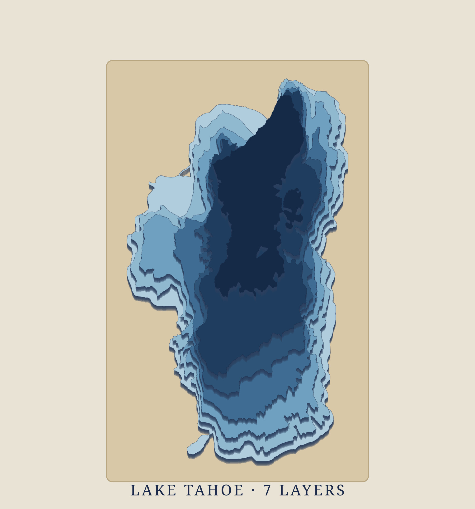

# Lake Tahoe layered depth map: free laser cut file (SVG + DXF)

**[Download the zip (SVG + DXF + README)](https://github.com/pinevolt/lake-tahoe-laser-depth-map/releases/latest/download/lake-tahoe-free-layers.zip)** · free, no sign-up

Lake Tahoe is 1,637 ft deep. These files turn the U.S. Geological Survey's 1998 multibeam depth survey into seven
stacked layers for a laser cutter: the shoreline, then the water deeper than 300, 780, 1,200, 1,420, 1,480 and
1,560 ft. Cut each layer from 3 mm stock and glue them in order, with the deep water on top, to get a 3D depth map
of the lake. The picture above is a render; it has not been cut by us yet.

## Files
| File | What it is |
|---|---|
| `lake-tahoe-laser.svg` | Cut file. Page 194.7 x 320 mm, map 174.7 x 300 mm. One group per layer, 0.1 mm hairlines, each layer in its own colour. A small black "engrave" line holds the lake name and depths (engrave it or delete it). |
| `lake-tahoe-layers.dxf` | The same 7 layers as DXF layers `L0_shoreline` to `L6_1560ft`, units set to millimetres (`$INSUNITS` = 4). |
| `lake-tahoe-preview.jpg` | The render above. |
| `LICENSE.txt` | What you may do with the files. |

**Units:** everything is in millimetres. If your software shows the page as about 195 x 320 *inches*, or the map
about 25 times too big, set the import units to millimetres and import again.

## How to cut
1. All layers sit at the same position, so they line up. Show one layer at a time and cut it.
2. Cut each layer from 3 mm stock (birch plywood, MDF or acrylic). Set the coloured lines to cut, not engrave.
3. On beds under 320 mm deep, rotate the page 90 degrees (laid sideways it is 320 x 194.7 mm). On a smaller bed,
   scale every layer by the same amount.
4. **Stacked:** glue the pieces in order, layer 0 at the bottom and the deepest layer on top; the deep water stands
   highest. **Carved:** add a rectangle around the map and cut each layer as a hole in its own board; stack the
   boards with layer 0's board on top, so the opening narrows as it goes down like the real lake bed.
5. Optional: paint or stain the layers from light to dark, or alternate two woods.

Specks too small to cut or glue (pieces and holes under about 6 x 6 mm, wood under 1 mm wide) were removed, so the
7 layers have 9 outlines. Fannette Island stays as a hole in layer 0.

## Data and credit
Data: U.S. Geological Survey, Gardner et al. (1999), Lake Tahoe multibeam bathymetry, 10 m grid (USGS DDS-55).
Survey year 1998. Depths in feet below a lake level of 1,899 m (6,230 ft). USGS data is in the public domain.

**Not for navigation.** Depths come from a historical survey and may be out of date or incomplete. Do not use this
map for boating, fishing safety or any decision about where it is safe to go on the water.

## Licence
Free for personal use. You may sell or gift what you cut from these files. Please don't resell or redistribute the
files themselves; link people to this page instead. Full text: `LICENSE.txt`.

More lakes: depthlines.etsy.com, 15% off laser files with code TAHOEMAKER until Dec 31, 2026.

Depth Lines is a service of Small Hours Co.
